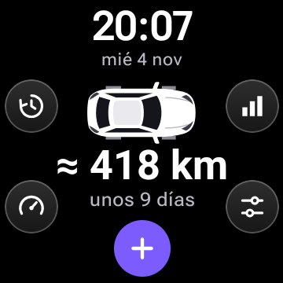
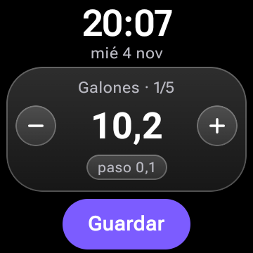
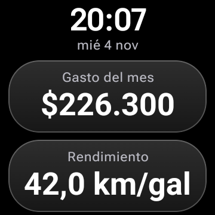
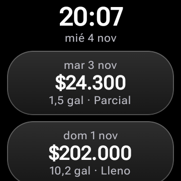
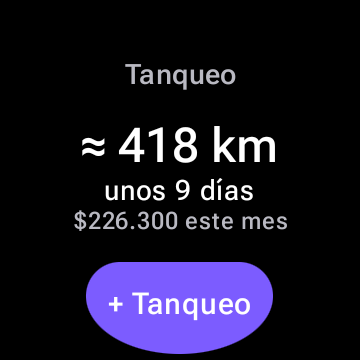
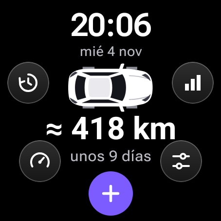
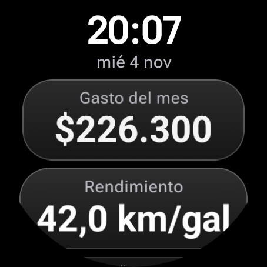
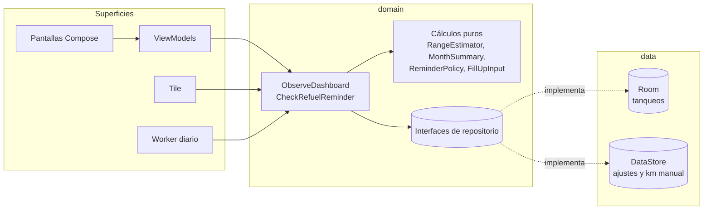

# Tanqueo

App para **smartwatch Wear OS** que registra cada vez que le pones gasolina a tu vehículo, estima cuánto te dura y te avisa cuándo volver a tanquear. Funciona solo en el reloj: sin app de celular, sin cuenta y sin Firebase.

Proyecto académico.

| Inicio | Registrar | Resumen |
|---|---|---|
|  |  |  |

| Historial | Tile | Inicio en reloj redondo |
|---|---|---|
|  |  |  |

| Registrar en redondo | Resumen en redondo | Tile en redondo |
|---|---|---|
|  |  |  |

## Funciones

- **Inicio.** Hora y fecha en español, un carro visto desde arriba (vector propio, sin marcas reales), los km y días restantes y botones circulares de vidrio: **+ Tanqueo** (violeta), Historial, Resumen, Actualizar km y Ajustes.
- **Registrar.** Una tarjeta por dato: galones, valor pagado en COP, combustible (Corriente, Extra, Diésel), tanque lleno o parcial y kilometraje. El valor grande cambia con la corona, el bisel o los botones − y +; desliza hacia arriba para pasar a la siguiente tarjeta. Tocar *paso* cambia el tamaño del ajuste. La fecha y la hora son automáticas.
  - Parte de tu último tanqueo: con los mismos galones y combustible y el valor calculado con el último precio, se puede guardar en pocos toques. El valor sigue a los galones hasta que lo editas.
  - El kilometraje queda vacío hasta que lo tocas: nunca se guarda uno que no elegiste. El odómetro no puede bajar del último registrado.
- **Historial.** Del más reciente al más antiguo; tocar uno muestra el detalle y permite borrarlo (con un segundo toque de confirmación).
- **Resumen del mes.** Gasto del mes, rendimiento en km/galón, precio promedio por galón, número de tanqueos y días desde el último.
- **Actualizar km.** Registra el kilometraje actual para que la estimación use km reales.
- **Aviso de tanquear.** Un trabajo diario de WorkManager revisa la estimación y notifica cuando quedan menos de 50 km o menos de 1 día.
- **Ajustes.** Capacidad del tanque, umbrales del aviso y estado de las notificaciones.
- **Tile.** Km y días restantes, gasto del mes y un botón **+ Tanqueo** que abre directamente el registro.

## Cómo se calcula la estimación

Toda la lógica está en funciones puras (`domain/calc`), sin dependencias de Android y con tests.

### 1. Rendimiento (km/galón): método de tanque lleno

Un tramo va de un tanque lleno con km al siguiente tanque lleno con km:

```
km/galón del tramo = km entre los dos llenos ÷ galones cargados después del primero, hasta el segundo inclusive
```

Si no hubo parciales en medio, los galones son exactamente los del segundo lleno. Si los hubo, también se suman, porque esa gasolina se consumió en el mismo recorrido; de lo contrario el rendimiento saldría inflado. El resultado es el promedio de los últimos 5 tramos.

### 2. Km por día

```
km por día = suma de km entre tanqueos consecutivos con km ÷ suma de días entre ellos   (últimos 5 tramos)
```

Aquí sí cuentan los parciales. Con menos de un día de historia no se calcula: dos tanqueos el mismo día darían un promedio absurdo.

### 3. Galones tras el último tanqueo

- Si fue **lleno**: la capacidad del tanque.
- Si fue **parcial**: se parte del último lleno y, tramo por tramo, se resta lo consumido (km ÷ rendimiento) y se suma lo cargado, sin pasar de la capacidad. Si un tramo no tiene km, se estima con el promedio diario.

### 4. Autonomía restante

```
autonomía = galones tras el último tanqueo × rendimiento − km recorridos desde entonces
días      = autonomía ÷ km por día
```

Los km recorridos se **estiman** con el promedio diario, o son **reales** si hay un "Actualizar km" posterior al último tanqueo. Si esa lectura ya tiene días, se suma el promedio diario solo por los días transcurridos desde ella; justo después de registrarla, el valor es exactamente el real. Se ignora una lectura anterior al último tanqueo, una menor que su odómetro, o cualquiera si el último tanqueo no tiene km. La autonomía nunca es negativa.

### Sin datos suficientes

No se inventan cifras. Sin dos llenos con km, sin ningún lleno o sin forma de saber los km recorridos, se muestra *"Registra otro tanqueo con km para estimar"* y el aviso no se dispara.

### Ejemplo con los datos de prueba

| Hace | Galones | Tipo | Km |
|---|---|---|---|
| 31 días | 10,2 | Lleno | 40.120 |
| 22 días | 10,5 | Lleno | 40.560 |
| 17 días | 5,0 | Parcial | 40.810 |
| 12 días | 6,7 | Lleno | 41.050 |
| 3 días | 10,2 | Lleno | 41.480 |
| 1 día | 1,5 | Parcial | 41.580 |

- Rendimiento: 440 ÷ 10,5 = 41,9; 490 ÷ (5,0 + 6,7) = 41,9; 430 ÷ 10,2 = 42,2. Promedio ≈ **42,0 km/galón**.
- Km por día: 1.460 km ÷ 30 días ≈ **48,7 km/día**.
- Tanque (12 gal): 12 − 100 ÷ 42,0 + 1,5 ≈ **11,1 galones** tras el último tanqueo.
- Autonomía: 11,1 × 42,0 − 1 día × 48,7 ≈ **418 km**, unos 418 ÷ 48,7 ≈ **9 días**: `≈ 418 km · unos 9 días`.

## Arquitectura

MVVM en un solo módulo, por capas. La UI solo conoce el dominio; los datos se inyectan con Hilt.



```
app/src/main/java/com/tanqueo
├── domain      modelos, cálculos puros, formatos e interfaces (sin Android)
├── data        Room y DataStore
├── di          módulos de Hilt
├── ui          tema, componentes de vidrio y una carpeta por pantalla
├── reminder    worker diario y notificación
└── tile        servicio y diseño de la tile
app/src/debug   datos de ejemplo y receptor para forzar el aviso (no llegan a release)
```

**Tecnología:** Kotlin, Jetpack Compose for Wear OS (Material 3), `SwipeDismissableNavHost`, Hilt, Room, DataStore, WorkManager y Tiles con ProtoLayout. Textos en `strings.xml`. Pesos colombianos con punto de miles (`$164.700`) y fechas en español (`mié 4 nov`).

**Formatos de reloj:** todas las medidas son proporcionales al lado corto de la pantalla (`ScreenSize`). En Inicio, los botones laterales siguen el borde del círculo en relojes redondos y se abren hacia las esquinas en los cuadrados. Revisado en emuladores de 180 dp (cuadrado) y 227 dp (redondo).

## Cómo ejecutarla

Requisitos: Android Studio con el SDK de Android (plataforma 37) y una imagen de sistema de Wear OS.

```bash
# Crear los emuladores (una sola vez). Requiere las "Command-line Tools" del SDK.
IMG="system-images;android-37.0;android-wear-signed;arm64-v8a"
sdkmanager "$IMG"
echo no | avdmanager create avd -n Wear_Cuadrado_API_37 -k "$IMG" -d wearos_square
echo no | avdmanager create avd -n Wear_Redondo_API_37  -k "$IMG" -d wearos_large_round

# Arrancar uno, compilar, instalar y abrir
emulator -avd Wear_Cuadrado_API_37 &
./gradlew installDebug
adb shell am start -n com.tanqueo/.MainActivity
```

En la variante **debug** se cargan una sola vez seis tanqueos de ejemplo con kilometraje, con fechas relativas al día de hoy. La variante release empieza vacía.

### Tests

```bash
./gradlew testDebugUnitTest
```

Cubren rendimiento, km por día, autonomía (pocos datos, tanqueos parciales, kilometraje actualizado a mano), resumen del mes, reglas del aviso, formatos, entrada con la corona, ViewModels y el repositorio de Room.

### Probar la tile

```bash
# Agregarla y mostrarla
adb shell am broadcast -a com.google.android.wearable.app.DEBUG_SURFACE \
  --es operation add-tile --ecn component com.tanqueo/.tile.TanqueoTileService
adb shell am broadcast -a com.google.android.wearable.app.DEBUG_SYSUI \
  --es operation show-tile --ei index 0
```

También se puede agregar a mano: desde la carátula, desliza hasta el final de las tiles, toca **+** y elige Tanqueo. El botón **+ Tanqueo** abre directamente el registro y, al guardar, la tile se actualiza.

### Forzar el aviso de tanquear (solo debug)

```bash
# Sube el umbral a 2.000 km y corre ya el worker: llega la notificación
adb shell am broadcast -n com.tanqueo/.debug.ForceReminderReceiver --ei umbral_km 2000

# Corre el worker con los umbrales actuales; con los normales no debería notificar
adb shell am broadcast -n com.tanqueo/.debug.ForceReminderReceiver

# Vuelve al umbral normal
adb shell am broadcast -n com.tanqueo/.debug.ForceReminderReceiver --ei umbral_km 50
```

El permiso de notificaciones se pide al abrir la app por primera vez y se puede activar luego desde Ajustes.

### Probar la corona o el bisel

En el emulador: *Extended controls → Rotary input*, o por adb:

```bash
adb shell input rotaryencoder scroll --axis SCROLL,-1
```
