# Tanqueo

App para **smartwatch Wear OS** que registra cada vez que le pones gasolina a tu vehículo, estima cuánto te dura y te avisa cuándo volver a tanquear. Funciona solo en el reloj: sin app de celular, sin cuenta y sin Firebase.

Proyecto académico.

| Mi vehículo | Autonomía | Este mes |
|---|---|---|
| 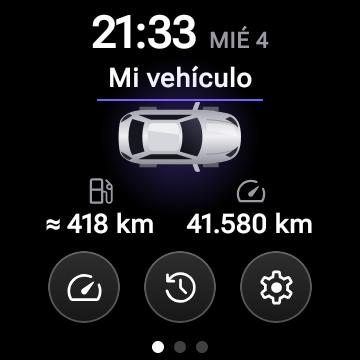 | 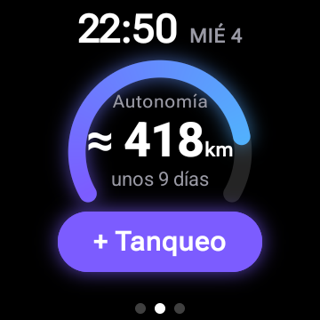 | 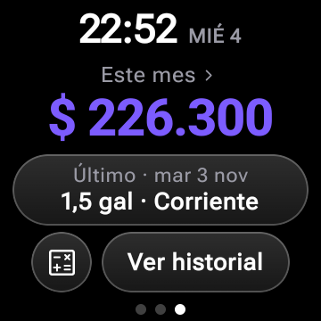 |
| 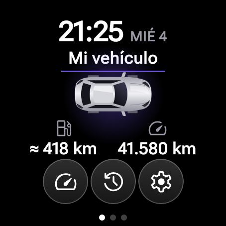 | 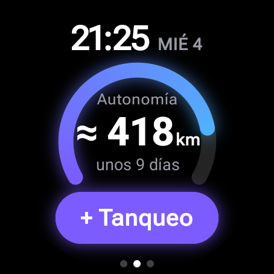 | 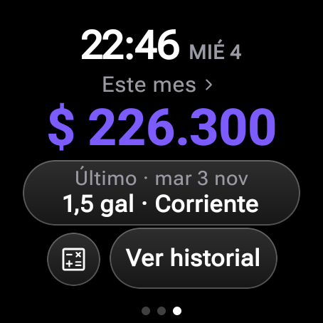 |

| Registrar | Tile | Complicación en una carátula |
|---|---|---|
| 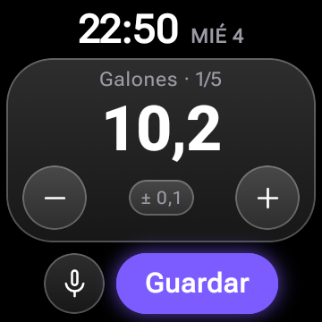 | 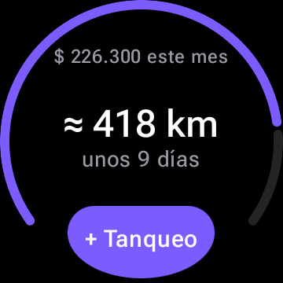 | 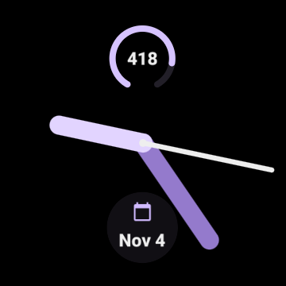 |
| 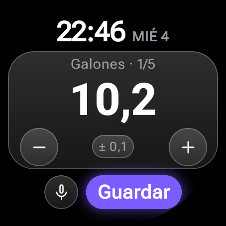 | 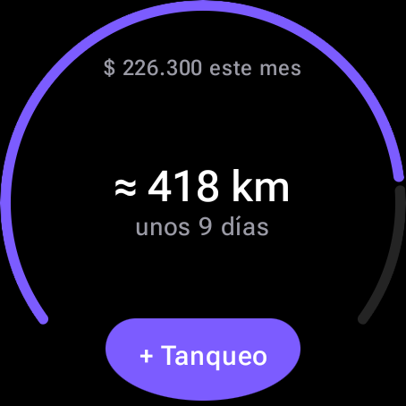 | 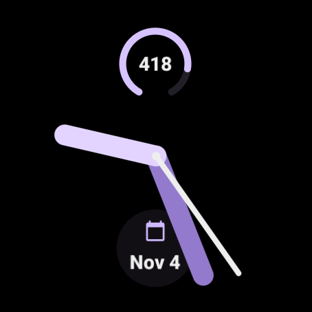 |

| Dictado: revisar | ¿Cuánto me alcanza? | Consejo del mes |
|---|---|---|
| 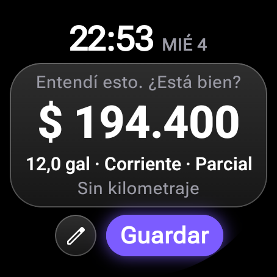 | 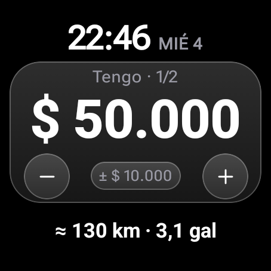 | 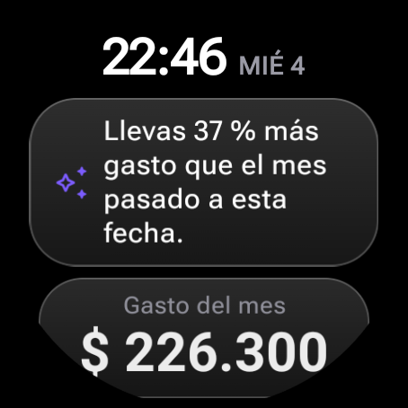 |

| Poca autonomía | Sin tanqueos | Al guardar |
|---|---|---|
| 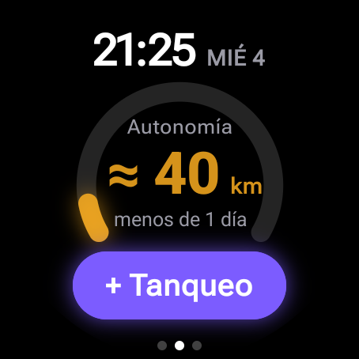 | 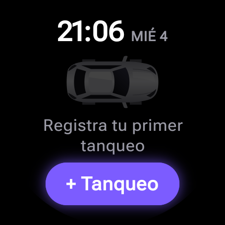 | 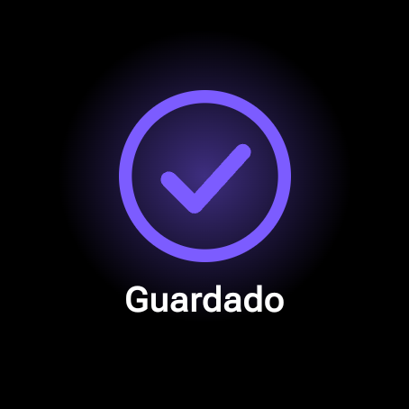 |

## Funciones

- **Inicio de 3 páginas** que se deslizan en horizontal (también con la corona o el bisel), con puntos de página abajo:
  1. **Mi vehículo:** carro visto desde arriba (vector propio, sin marcas reales), autonomía y odómetro, y botones de vidrio para Actualizar km, Historial y Ajustes.
  2. **Autonomía:** anillo tipo medidor que se llena según el % de tanque estimado, con los km, los días y el botón **+ Tanqueo**.
  3. **Este mes:** gasto del mes, último tanqueo y **Ver historial**. Tocar el gasto abre el resumen completo: rendimiento, precio promedio por galón, número de tanqueos y días desde el último.
- **Registrar.** Una tarjeta por dato: galones, valor pagado en COP, combustible (Corriente, Extra, Diésel), tanque lleno o parcial y kilometraje. El número enorme cambia con la corona, el bisel o los botones; desliza hacia arriba para pasar de tarjeta. Tocar el chip `±` cambia el tamaño del paso. La fecha y la hora son automáticas.
  - Parte de tu último tanqueo: con los mismos galones y combustible y el valor calculado con el último precio, se puede guardar en pocos toques. El valor sigue a los galones hasta que lo editas.
  - El kilometraje queda vacío hasta que lo tocas: nunca se guarda uno que no elegiste. El odómetro no puede bajar del último registrado.
  - **Por voz o teclado:** el micrófono abre la entrada del sistema. Dices "10 galones, 165 mil, corriente, lleno", la app llena las tarjetas y **tú revisas antes de guardar**.
- **¿Cuánto me alcanza?** (botón de calculadora en "Este mes"). Eliges el dinero y el precio del galón, y ves los km y galones al instante. Los km usan el rendimiento real de tu vehículo; sin datos suficientes solo muestra galones. Lo que no cabe en el tanque no suma km.
- **Historial.** Del más reciente al más antiguo; tocar uno muestra el detalle y permite borrarlo (con un segundo toque de confirmación).
- **Consejo del mes** (en el resumen). Calculado con tus datos reales; si hay IA, ella lo redacta.
- **Actualizar km.** Registra el kilometraje actual para que la estimación use km reales.
- **Aviso de tanquear.** Un trabajo diario de WorkManager revisa la estimación y notifica cuando quedan menos de 50 km o menos de 1 día.
- **Ajustes.** Capacidad del tanque, umbrales del aviso y estado de las notificaciones.
- **Tile.** Arco de progreso por el borde, km y días, gasto del mes y **+ Tanqueo**, que abre directamente el registro.
- **Complicación.** Km restantes para cualquier carátula, con arco de progreso (`RANGED_VALUE`) o como texto corto (`SHORT_TEXT`). El dato trae el degradado violeta → azul, pero cada carátula decide si lo respeta: en las capturas se usó el tema *Lilac* de la carátula.

## Inteligencia artificial

La app usa **Gemini por Firebase AI Logic**. La IA **solo interpreta y redacta**; las cifras salen siempre de los cálculos locales.

| Función | Con IA | Sin IA o sin internet |
|---|---|---|
| Dictado | Entiende frases sueltas | Un lector local entiende frases simples, también con números en palabras |
| Consejo del mes | Lo redacta en una frase | Se muestra el consejo calculado en el reloj |

Controles para que no invente datos:

- **Dictado:** lo que no se dijo queda como estaba, los valores imposibles se descartan y nada se guarda sin tu confirmación.
- **Consejo:** se rechaza si trae una cifra que no esté en los datos que recibió.
- **Sin espera larga:** si no responde en 12 s, la app sigue sin ella.

**Privacidad:** el texto dictado se envía a Google para interpretarlo, y para el consejo se envían solo agregados (gasto, precios promedio y rendimiento), sin fechas exactas ni kilometraje. No se envía nada más.

### Precios de referencia

"¿Cuánto me alcanza?" incluye los precios de referencia de **noviembre de 2026** publicados por la CREG (Circular 371 de 2026), en `domain/budget/ReferencePrices.kt`. El precio real varía según la estación y estos valores se actualizan a mano. No hay precio de referencia publicado para la Extra: esa se calcula con tu propio último precio.

## Diseño

Inspirado en el estilo de las imágenes de `docs/referencias`, sin copiar logos, marcas ni diseños exactos.

- **Fondo negro puro** para que el reloj se vea elegante y ahorre batería en OLED.
- **Vidrio oscuro:** gris translúcido, borde de 1 dp más claro y esquinas muy redondeadas.
- **Un solo acento,** violeta `#7C5CFF`, con resplandor detrás del anillo, el botón principal y el carro. El degradado violeta → azul (`#4AC0FC`) aparece solo en el anillo.
- **Números grandes y gruesos,** etiquetas pequeñas en gris `#9A9AA5` y poca información por pantalla. Íconos [Material Symbols Rounded](https://fonts.google.com/icons) (Apache 2.0).
- **Animaciones:** el anillo se llena, los números cuentan hasta su valor y las tarjetas aparecen con un fundido. Al guardar se dibuja un check violeta antes de volver.
- **Vibración** corta al girar la corona y al guardar.
- **Alerta:** con menos de 50 km el anillo y la cifra pasan a ámbar, y con menos de 20 km a rojo, con un pulso suave. Estos niveles son fijos y no dependen de los umbrales del aviso.
- **Accesibilidad:** botones con área de toque de al menos 48 dp, aunque el círculo visible sea menor, y contraste de la paleta comprobado con tests. El blanco sobre violeta da 4,3:1, suficiente para texto grande; por eso esos botones van en negrita.

## Cómo se calcula la estimación

Toda la lógica está en funciones puras (`domain/calc`), sin dependencias de Android y con tests.

### 1. Rendimiento (km/galón): método de tanque lleno

Un tramo va de un tanque lleno con km al siguiente tanque lleno con km:

```
km/galón del tramo = km entre los dos llenos ÷ galones cargados después del primero, hasta el segundo inclusive
```

Si no hubo parciales en medio, los galones son exactamente los del segundo lleno. Si los hubo, también se suman, porque esa gasolina se consumió en el mismo recorrido; de lo contrario el rendimiento saldría inflado. El resultado es el promedio de los últimos 5 tramos.

### 2. Km por día

```
km por día = suma de km entre tanqueos consecutivos con km ÷ suma de días entre ellos   (últimos 5 tramos)
```

Aquí sí cuentan los parciales. Con menos de un día de historia no se calcula: dos tanqueos el mismo día darían un promedio absurdo.

### 3. Galones tras el último tanqueo

- Si fue **lleno**: la capacidad del tanque.
- Si fue **parcial**: se parte del último lleno y, tramo por tramo, se resta lo consumido (km ÷ rendimiento) y se suma lo cargado, sin pasar de la capacidad. Si un tramo no tiene km, se estima con el promedio diario.

### 4. Autonomía restante

```
autonomía = galones tras el último tanqueo × rendimiento − km recorridos desde entonces
días      = autonomía ÷ km por día
```

Los km recorridos se **estiman** con el promedio diario, o son **reales** si hay un "Actualizar km" posterior al último tanqueo. Si esa lectura ya tiene días, se suma el promedio diario solo por los días transcurridos desde ella; justo después de registrarla, el valor es exactamente el real. Se ignora una lectura anterior al último tanqueo, una menor que su odómetro, o cualquiera si el último tanqueo no tiene km. La autonomía nunca es negativa.

### Sin datos suficientes

No se inventan cifras. Sin dos llenos con km, sin ningún lleno o sin forma de saber los km recorridos, se muestra *"Registra otro tanqueo con km para estimar"* y el aviso no se dispara.

### Ejemplo con los datos de prueba

| Hace | Galones | Tipo | Km |
|---|---|---|---|
| 31 días | 10,2 | Lleno | 40.120 |
| 22 días | 10,5 | Lleno | 40.560 |
| 17 días | 5,0 | Parcial | 40.810 |
| 12 días | 6,7 | Lleno | 41.050 |
| 3 días | 10,2 | Lleno | 41.480 |
| 1 día | 1,5 | Parcial | 41.580 |

- Rendimiento: 440 ÷ 10,5 = 41,9; 490 ÷ (5,0 + 6,7) = 41,9; 430 ÷ 10,2 = 42,2. Promedio ≈ **42,0 km/galón**.
- Km por día: 1.460 km ÷ 30 días ≈ **48,7 km/día**.
- Tanque (12 gal): 12 − 100 ÷ 42,0 + 1,5 ≈ **11,1 galones** tras el último tanqueo.
- Autonomía: 11,1 × 42,0 − 1 día × 48,7 ≈ **418 km**, unos 418 ÷ 48,7 ≈ **9 días**: `≈ 418 km · unos 9 días`.

## Arquitectura

MVVM en un solo módulo, por capas. La UI solo conoce el dominio; los datos se inyectan con Hilt.

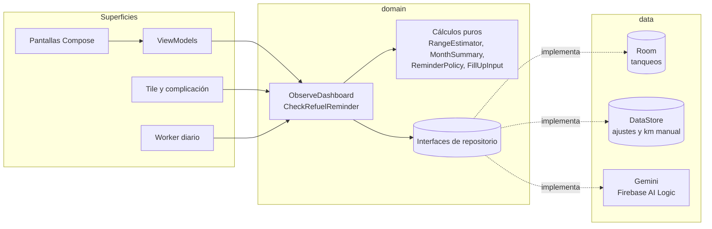

```
app/src/main/java/com/tanqueo
├── domain      modelos, cálculos puros, lector de dictado, calculadora y consejo (sin Android)
├── data        Room, DataStore y Gemini
├── di          módulos de Hilt
├── ui          tema, componentes de vidrio y una carpeta por pantalla
├── reminder    worker diario y notificación
├── tile        servicio y diseño de la tile
└── complication  datos de la complicación para las carátulas
app/src/debug   datos de ejemplo y receptores de demo (no llegan a release)
```

**Tecnología:** Kotlin, Jetpack Compose for Wear OS (Material 3), `SwipeDismissableNavHost`, Hilt, Room, DataStore, WorkManager, Tiles con ProtoLayout, complicaciones y Firebase AI Logic con App Check. Textos en `strings.xml`. Pesos colombianos con punto de miles (`$ 164.700`) y fechas en español (`MIÉ 4`).

**Formatos de reloj:** todas las medidas son proporcionales al lado corto de la pantalla (`ScreenSize`), con ajustes para que en los relojes redondos nada toque el borde del círculo. Revisado en emuladores de 180 dp (cuadrado) y 227 dp (redondo).

## Cómo ejecutarla

Requisitos: Android Studio con el SDK de Android (plataforma 37) y una imagen de sistema de Wear OS.

```bash
# Crear los emuladores (una sola vez). Requiere las "Command-line Tools" del SDK.
IMG="system-images;android-37.0;android-wear-signed;arm64-v8a"
sdkmanager "$IMG"
echo no | avdmanager create avd -n Wear_Cuadrado_API_37 -k "$IMG" -d wearos_square
echo no | avdmanager create avd -n Wear_Redondo_API_37  -k "$IMG" -d wearos_large_round

# Arrancar uno, compilar, instalar y abrir
emulator -avd Wear_Cuadrado_API_37 &
./gradlew installDebug
adb shell am start -n com.tanqueo/.MainActivity
```

En la variante **debug** se cargan una sola vez seis tanqueos de ejemplo con kilometraje, con fechas relativas al día de hoy. La variante release empieza vacía.

### Activar la IA (opcional)

Sin este paso la app compila y funciona con el lector local.

1. En [Firebase console](https://console.firebase.google.com), abre tu proyecto y registra una app Android con el paquete `com.tanqueo`. Descarga `google-services.json` en `app/` (no se versiona).
2. En **AI Logic**, activa el proveedor **Gemini Developer API**, si el proyecto no lo tiene ya.
3. En **App Check**, registra la app y agrega como token de depuración el valor de `APP_CHECK_DEBUG_TOKEN` de tu `local.properties` (no se versiona). Puedes generar uno con `uuidgen`.
4. Vuelve a instalar con `./gradlew installDebug`.

### Tests

```bash
./gradlew testDebugUnitTest
```

Cubren rendimiento, km por día, autonomía (pocos datos, tanqueos parciales, kilometraje actualizado a mano), % de tanque, niveles de alerta, resumen del mes, reglas del aviso, formatos, entrada con la corona, contraste de la paleta, complicación, lector de dictado, calculadora, consejo y su filtro de cifras, ViewModels y el repositorio de Room.

### Probar la tile

```bash
# Agregarla y mostrarla
adb shell am broadcast -a com.google.android.wearable.app.DEBUG_SURFACE \
  --es operation add-tile --ecn component com.tanqueo/.tile.TanqueoTileService
adb shell am broadcast -a com.google.android.wearable.app.DEBUG_SYSUI \
  --es operation show-tile --ei index 0
```

También se puede agregar a mano: desde la carátula, desliza hasta el final de las tiles, toca **+** y elige Tanqueo. El botón **+ Tanqueo** abre directamente el registro y, al guardar, la tile se actualiza.

### Forzar el aviso de tanquear (solo debug)

```bash
# Sube el umbral a 2.000 km y corre ya el worker: llega la notificación
adb shell am broadcast -n com.tanqueo/.debug.ForceReminderReceiver --ei umbral_km 2000

# Corre el worker con los umbrales actuales; con los normales no debería notificar
adb shell am broadcast -n com.tanqueo/.debug.ForceReminderReceiver

# Vuelve al umbral normal
adb shell am broadcast -n com.tanqueo/.debug.ForceReminderReceiver --ei umbral_km 50
```

El permiso de notificaciones se pide al abrir la app por primera vez y se puede activar luego desde Ajustes.

### Probar la complicación

Mantén presionada la carátula → lápiz → desliza hasta **Complicaciones** → toca una ranura → elige **Autonomía de Tanqueo**.

### Ver los estados especiales (solo debug)

```bash
# Alerta ámbar con 40 km, o roja con 12
adb shell am broadcast -n com.tanqueo/.debug.DemoReceiver --ei km_restantes 40

# Estado vacío
adb shell am broadcast -n com.tanqueo/.debug.DemoReceiver --ez vaciar true

# Volver a los datos de ejemplo
adb shell pm clear com.tanqueo
```

### Probar la corona o el bisel

En el emulador: *Extended controls → Rotary input*, o por adb:

```bash
adb shell input rotaryencoder scroll --axis SCROLL,-1
```
